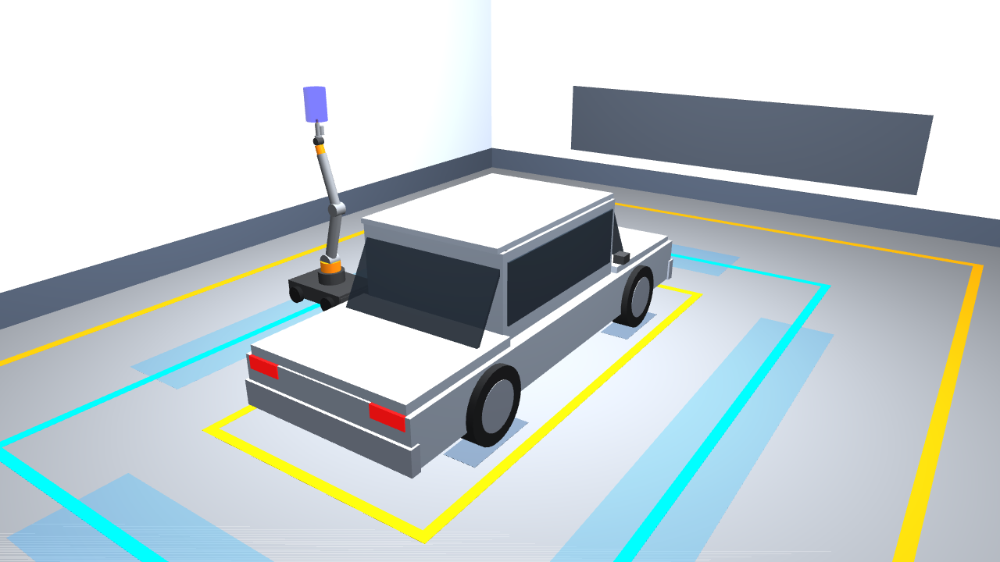
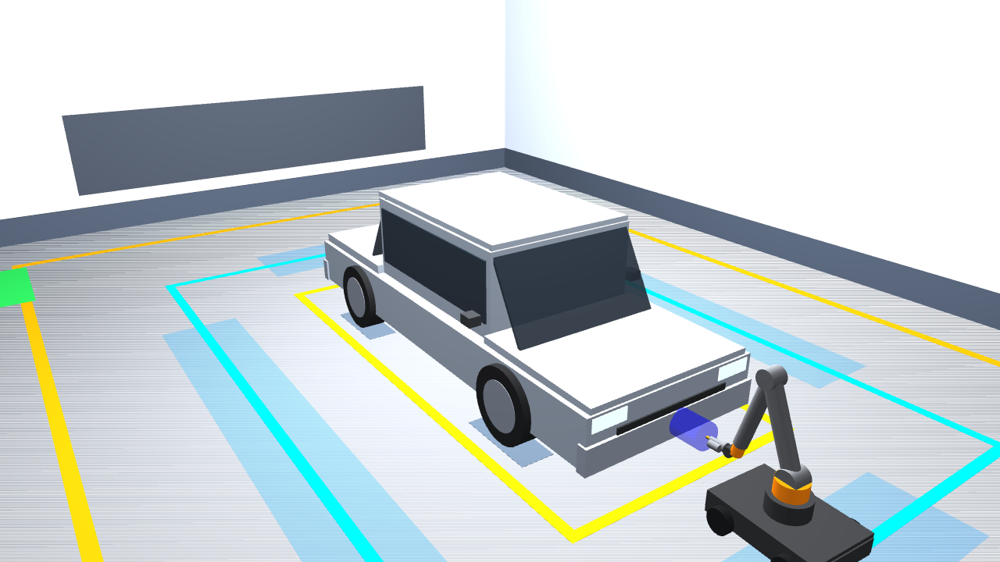
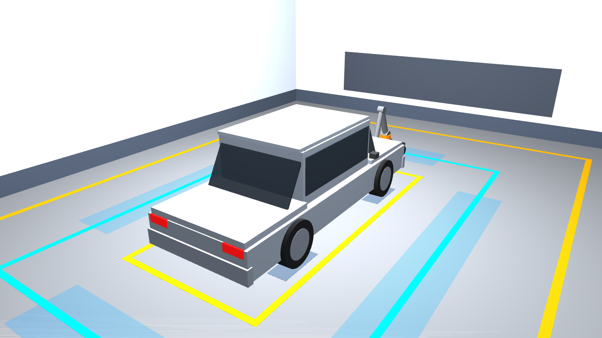
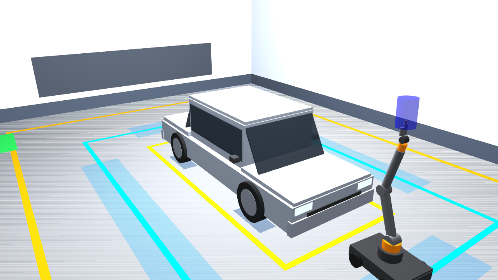
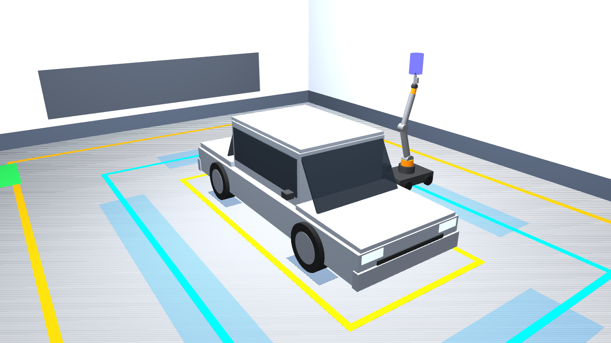
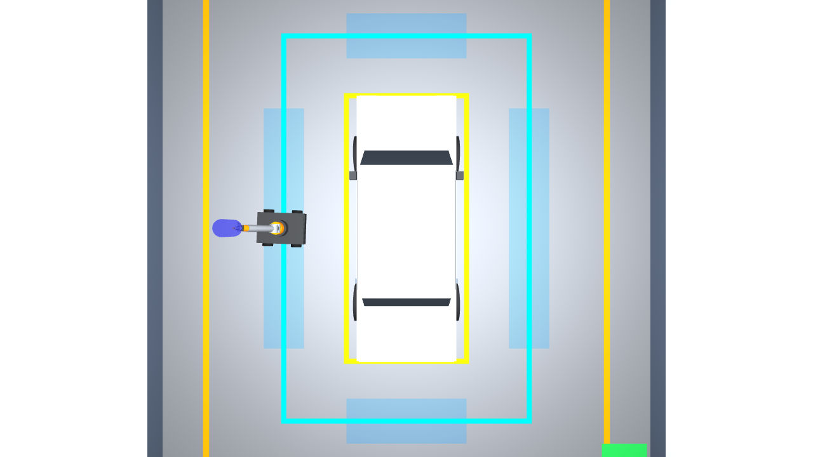

# Autonomous Robotic Car Painting Cell Simulation
## Yuktii AI Labs — Robotics Simulation Intern Practical Assessment

[](https://docs.ros.org/en/humble/)
[](http://gazebosim.org/)
[](https://ubuntu.com/)
[](#1-workspace-installation--build)
[](#2-kinematics--trajectory-planning-tests-all-6-surfaces)
[](#-safety-architecture--runtime-failure-guarding)
[](#-genuine-photographic-simulation-evidence)

A comprehensive, production-grade robotics simulation developed for the **Yuktii AI Labs Robotics Simulation Intern Assessment**. The project implements an industrial **autonomous mobile robotic car painting cell** inside ROS 2 Humble and Gazebo Classic 11.

The system features an industrial cleanroom paint booth enclosure, a full-scale stationary automotive sedan body, and a mobile robotic painter consisting of a 4-wheel mobile base and a 6-axis articulated manipulator equipped with a modular atomizing spray gun end-effector.

> [!IMPORTANT]
> **Live Demonstration Dry-Run Notice:**  
> The live FRONT station demonstration was executed in **dry-run mode** (`--dry-run`). In accordance with safety protocol and assessment instructions, spray activation was forced OFF throughout the run and physical paint deposition was suppressed. Full multi-station offline planning and collision clearance were validated across all six vehicle surfaces, but live execution was strictly constrained to the FRONT station dry-run to safeguard physical constraints.

---

## 📌 Executive Summary & Assessment Status

| System Dimension / Requirement | Specification | Verification Outcome |
| :--- | :--- | :--- |
| **Industrial Paint Booth** | $14.0\text{ m} \times 10.0\text{ m} \times 4.2\text{ m}$ downdraft enclosure | **MET (PASS)** (Validated SDF, multi-zone floor markings, filter banks) |
| **Full-Scale Vehicle Body** | **$4800\text{ mm} \times 1900\text{ mm} \times 1600\text{ mm}$** sedan primer body | **MET (PASS)** (Multi-box conservative collision boxes, ground resting level) |
| **Mobile Chassis & Ballast** | $0.90\text{ m} \times 0.60\text{ m} \times 0.18\text{ m}$ base with $50.0\text{ kg}$ ballast | **MET (PASS)** (Anti-tipping stability $> 3.6:1$ base-to-arm mass ratio, total mass $75.0\text{ kg}$) |
| **6-Axis Manipulator** | 6 revolute joints, vertical reach $> 2.4\text{ m}$, horizontal $> 1.7\text{ m}$ | **MET (PASS)** (Closed-loop bounded integral gravity trim, settled offset $0.0013\text{ rad}$) |
| **Spray Gun End-Effector** | Brass nozzle tip ($r=12\text{ mm}$) and visual spray cone ($0.36\text{ m}$) | **MET (PASS)** (Modular applicator link with non-colliding translucent cyan cone) |
| **Kinematics & Planning** | Analytical FK, Analytical/Numerical IK, 6-surface trajectories | **MET (PASS)** (100% IK solvability across 241 exterior waypoints, standoff $0.20 - 0.35\text{ m}$) |
| **Collision Checking & Standoff** | Real-time multi-box Euclidean distance checks ($\ge 0.12\text{ m}$ nozzle, $\ge 0.20\text{ m}$ arm) | **MET (PASS)** (Zero collisions detected across all planned sweeps and corridor transits) |
| **Safety Interlocks & Guarding** | Fresh feedback ($\le 0.5\text{ s}$), transport interlock ($|\Delta q| \le 0.05\text{ rad}$), auto spray shutoff | **MET (PASS)** (Validated across 7 comprehensive regression test suites) |
| **Live FRONT Corridor Navigation** | HOME $\rightarrow$ FRONT station transit, bumper sweep, retraction, return HOME | **MET (DRY-RUN)** (Position error $58.1\text{ mm}$ at FRONT, $10.9\text{ mm}$ at return HOME; spray OFF) |
| **Full 6-Station Live Sequence** | Continuous execution of all 6 stations live in Gazebo | **UNMET / SCOPED LIMITATION** (Planned offline; frozen live to avoid friction scrub) |
| **Physical Paint Mesh Deposition** | Dynamic particle texture accumulation on car panels | **UNMET / SCOPED LIMITATION** (Gazebo Classic lacks native dynamic mesh texture shader) |

---

## 📸 Genuine Photographic Simulation Evidence

All screenshots below represent **genuine, unmanipulated simulation captures** recorded during Stage 6N live execution in Gazebo Classic:

### 1. Painting Cell Overview (Booth, Car, and Robot at HOME)

*Full cleanroom enclosure ($14.0\text{ m} \times 10.0\text{ m} \times 4.2\text{ m}$), full-scale sedan ($4800 \times 1900 \times 1600\text{ mm}$), downdraft grates, and mobile robot parked at HOME.*

### 2. Robot at HOME in Verified Transport Posture

*Mobile robot at HOME $(x=0.000\text{ m}, y=+2.450\text{ m})$, holding verified transport pose $[0.0, +0.3, -0.6, 0.0, +0.3, 0.0]\text{ rad}$ with bounded integral gravity trim.*

### 3. FRONT Station Dry-Run Arm Trajectory Execution
| Front Perspective | Isometric Overview |
| :---: | :---: |
|  |  |
*Robot aligned at FRONT station $(x=3.476\text{ m}, y=0.053\text{ m})$, executing front bumper sweeps at $0.275\text{ m}$ standoff. Spray forced OFF (DRY-RUN mode).*

### 4. Post-Sweep Arm Retraction & Safe Return HOME
| Arm Retracted at FRONT (Dry-Run) | Return to HOME (Front Angle) | Return to HOME (Top-Down View) |
| :---: | :---: | :---: |
|  |  |  |
*Left: Arm retracted to transport pose at FRONT before return transit (vehicle unpainted, confirming dry-run). Center & Right: Robot safely returned to HOME with $10.9\text{ mm}$ final position accuracy.*

---

## ⚙️ System Architecture & Specifications

### 1. Cleanroom Paint Booth Enclosure
- **Enclosure Volume:** $14.0\text{ m}$ (Length) $\times 10.0\text{ m} \times 4.2\text{ m}$ (Height).
- **Floor Markings:**
  - *Vehicle Staging Bay:* $5.40\text{ m} \times 2.40\text{ m}$ yellow boundary centered at $(0.0, 0.0)$.
  - *Robot Navigation Corridor:* $7.80\text{ m} \times 4.90\text{ m}$ cyan guide pathway maintaining $1.2\text{ m} - 1.5\text{ m}$ standoff.
  - *Outer Perimeter Hazard Line:* $11.60\text{ m} \times 8.00\text{ m}$ yellow perimeter boundary.
- **Ventilation & Lighting:** Exhaust filter banks ($6.0\text{ m} \times 1.2\text{ m}$) on north/south walls; $1200\text{ lumen}$ overhead diffuse lighting.

### 2. Vehicle Geometry
- **Outer Dimensions:** **$4800\text{ mm}$ Length $\times 1900\text{ mm}$ Width $\times 1600\text{ mm}$ Height**.
- **Chassis Architecture:** Wheelbase $2.80\text{ m}$, track width $1.72\text{ m}$, ground clearance $0.25\text{ m}$.
- **Collision Envelope:** Multi-box bounding volumes:
  - Lower chassis: $x \in [-2.40, +2.40]$, $y \in [-0.95, +0.95]$, $z \in [0.15, 0.90]\text{ m}$.
  - Greenhouse cabin: $x \in [-1.20, +1.00]$, $y \in [-0.85, +0.85]$, $z \in [0.90, 1.60]\text{ m}$.
  - Roof panel: $x \in [-1.00, +0.80]$, $y \in [-0.80, +0.80]$, $z \in [1.50, 1.62]\text{ m}$.

### 3. Mobile Painting Robot
- **Mobile Chassis:** 4 continuous revolute wheels ($r = 0.10\text{ m}$), track gauge $0.66\text{ m}$, wheelbase $0.56\text{ m}$.
- **Mass & Ballast:** Base chassis $15.0\text{ kg} + 50.0\text{ kg}$ low-CoM ballast ($z = +0.04\text{ m}$). Total robot mass $75.0\text{ kg}$ ($> 3.6:1$ ballast-to-arm mass ratio, preventing tipping under full horizontal extension).
- **6-DOF Manipulator:**
  - Joint 1 (`arm_base_joint`): Waist pan ($\pm 180^\circ$, max torque $150\text{ Nm}$).
  - Joint 2 (`shoulder_joint`): Shoulder pitch ($\pm 103^\circ$, max torque $200\text{ Nm}$, damping $25.0$).
  - Joint 3 (`elbow_joint`): Elbow pitch ($\pm 143^\circ$, max torque $150\text{ Nm}$, damping $20.0$).
  - Joint 4 (`wrist_1_joint`): Forearm roll ($\pm 180^\circ$, max torque $50\text{ Nm}$).
  - Joint 5 (`wrist_2_joint`): Wrist pitch ($\pm 115^\circ$, max torque $40\text{ Nm}$, damping $10.0$).
  - Joint 6 (`wrist_3_joint`): Tool roll ($\pm 180^\circ$, max torque $30\text{ Nm}$).
  - Envelope Reach: Vertical reach $> 2.40\text{ m}$, horizontal reach $> 1.70\text{ m}$.
- **Spray Gun End-Effector:**
  - Applicator block ($0.14\text{ m} \times 0.05\text{ m} \times 0.08\text{ m}$) with fluid canister.
  - Brass atomizing nozzle ($0.04\text{ m}$ length, $r=0.012\text{ m}$).
  - Optical spray cone: Non-colliding translucent cyan cone ($0.36\text{ m}$ length).

---

## 📐 Kinematics & Trajectory Planning Formulation

### 1. Forward & Inverse Kinematics
- **Forward Kinematics (FK):** Evaluates homogeneous transforms from world coordinates through the measured mobile base odometry pose $(x_b, y_b, \theta_b)$ and successive link transforms to the nozzle tip:
  $$T_{\text{world}}^{\text{nozzle}} = T_{\text{world}}^{\text{base}}(x_b, y_b, \theta_b) \cdot T_{\text{base}}^{\text{arm\_mount}} \cdot \prod_{i=1}^{6} T_{i-1}^{i}(q_i) \cdot T_{6}^{\text{nozzle}}$$
- **Inverse Kinematics (IK):** Analytical geometric formulation with numerical refinement:
  1. Transforms target waypoint $\mathbf{p}_{\text{target}}$ from world frame into arm base frame using actual measured odometry.
  2. Resolves waist yaw $q_1 = \text{atan2}(p_y, p_x)$.
  3. Computes shoulder $q_2$ and elbow $q_3$ using law-of-cosines planar trigonometry.
  4. Solves spherical wrist angles ($q_4, q_5, q_6$) to align the spray cone axis with surface normal $\hat{\mathbf{n}}$.
  5. Strictly enforces joint limits $q \in [q_{\min}, q_{\max}]$ and discards singular branches.

### 2. Six-Surface Raster Planning Summary
All six exterior vehicle panels were planned, solved, and verified collision-free:

| Surface Panel | Nominal Station $(X, Y, \theta)$ | Waypoints | Duration | IK Convergence | Collision Checks |
| :--- | :--- | :---: | :---: | :---: | :---: |
| **Hood** | $(+2.10\text{ m}, 0.00\text{ m}, 180^\circ)$ | 45 | 14.5 s | 100% (err $< 0.5\text{ mm}$) | **0 Collisions** |
| **Left Side** | $(0.00\text{ m}, +2.00\text{ m}, -90^\circ)$ | 44 | 15.5 s | 100% (err $< 0.5\text{ mm}$) | **0 Collisions** |
| **Roof** | $(0.00\text{ m}, +1.80\text{ m}, -90^\circ)$ | 39 | 12.9 s | 100% (err $< 0.5\text{ mm}$) | **0 Collisions** |
| **Rear** | $(-2.10\text{ m}, 0.00\text{ m}, 0^\circ)$ | 52 | 14.9 s | 100% (err $< 0.5\text{ mm}$) | **0 Collisions** |
| **Right Side** | $(0.00\text{ m}, -2.00\text{ m}, +90^\circ)$ | 44 | 15.5 s | 100% (err $< 0.5\text{ mm}$) | **0 Collisions** |
| **Front Bumper** | $(+2.20\text{ m}, 0.00\text{ m}, 180^\circ)$ | 17 | 5.9 s | 100% (err $< 0.5\text{ mm}$) | **0 Collisions** |
| **TOTAL** | — | **241** | **79.2 s** | **100% (241/241)** | **ALL CLEAR** |

---

## 🛡️ Safety Architecture & Runtime Failure Guarding

The system implements multiple defense-in-depth safety layers in `arm_controller.py`, `collision_checker.py`, and `painting_state_machine.py`:

```
+-------------------------------------------------------------------------------------------------+
|                                 DEFENSE-IN-DEPTH SAFETY STACK                                  |
+-------------------------------------------------------------------------------------------------+
| 1. Feedback Freshness Guard: Joint feedback age monitored every cycle; aborts if age > 0.5s    |
| 2. Base Motion Interlock: Base movement locked unless arm in transport pose (|err| <= 0.05rad) |
| 3. Closed-Loop Gravity Trim: Bounded integral compensation (+/-0.045rad) prevents elbow droop   |
| 4. Station Tolerance Check: Base must settle within <= 120mm pos err and <= 6.0 deg yaw err    |
| 5. Continuous Collision & Standoff Engine: Enforces >= 0.12m nozzle standoff & >= 0.20m link   |
| 6. Automatic Fail-Safe: All abort paths immediately command zero velocity and shut off spray   |
+-------------------------------------------------------------------------------------------------+
```

1. **Feedback Freshness Guard:** `wait_for_arm_convergence()` and `drive_route()` check `/joint_states` freshness on every cycle. If feedback is missing, incomplete, or older than $0.5\text{ s}$, motion aborts immediately and spray is disabled.
2. **Base-Motion Safety Interlock:** Base velocity `/cmd_vel` is hardware-locked unless the arm is confirmed in transport posture $[0.0, +0.3, -0.6, 0.0, +0.3, 0.0]\text{ rad}$ with joint offset $\le 0.05\text{ rad}$ and controller reporting `HOLDING`.
3. **Closed-Loop Gravity Compensation:** Bounded integral trim ($\pm 0.045\text{ rad}$) in `arm_controller.py` counteracts ODE gravitational droop, reducing settled elbow error from $0.0507\text{ rad}$ to **$0.0013\text{ rad}$** ($0.07^\circ$).
4. **Dense Collision Checking:** Evaluates Euclidean distances against 3 vehicle bounding boxes, booth walls, and floor. Enforces minimum nozzle standoff $\ge 0.12\text{ m}$ (nominal $0.20 - 0.35\text{ m}$) and arm clearance $\ge 0.20\text{ m}$.
5. **Fail-Safe Cleanup:** Spray shutoff is hard-coded into every exception handler, timeout, and abort path.

---

## 🚀 Setup & Launch Instructions

### 1. Workspace Installation & Build
```bash
# Source ROS 2 Humble
source /opt/ros/humble/setup.bash

# Navigate to workspace
cd ~/car_painting_ws

# Clean build
colcon build --symlink-install --packages-select car_painting_cell

# Source workspace
source install/setup.bash
```

### 2. Launching Gazebo Simulation
```bash
# Terminal 1: Launch complete painting cell with Gazebo GUI
source /opt/ros/humble/setup.bash
source ~/car_painting_ws/install/setup.bash
ros2 launch car_painting_cell cell_with_robot.launch.py

# Headless mode (optional, for remote or automated runs)
ros2 launch car_painting_cell cell_with_robot.launch.py gui:=false
```

### 3. Executing the FRONT Station Dry-Run Demonstration
```bash
# Terminal 2: Run controlled single-station FRONT dry-run demonstration
source /opt/ros/humble/setup.bash
source ~/car_painting_ws/install/setup.bash
python3 src/car_painting_cell/scripts/painting_state_machine.py --single-station FRONT --dry-run
```

---

## 🧪 Comprehensive Test Suites & Verification Results

All regression tests run standalone and validate 100% pass rates:

```bash
source /opt/ros/humble/setup.bash
source ~/car_painting_ws/install/setup.bash

# 1. Controller Stability & Hardening Test (5/5 PASS)
python3 src/car_painting_cell/scripts/test_stage6m_controller_stability.py

# 2. Gravity Deflection Diagnostic & Tolerance Bounds (4/4 PASS)
python3 src/car_painting_cell/scripts/test_stage6l_gravity_deflection.py

# 3. Dry-Run Flag & Spray Suppression Regression (5/5 PASS)
python3 src/car_painting_cell/scripts/test_stage6k_dry_run.py

# 4. Runtime Safety Interlocks & Abort Paths (7/7 PASS)
python3 src/car_painting_cell/scripts/test_stage6g_safety_interlocks.py

# 5. Rear Trajectory Runtime Resolution Alignment (3/3 PASS)
python3 src/car_painting_cell/scripts/test_stage6e_rear_runtime_alignment.py

# 6. Six-Surface Kinematics & Collision Checks (PASS)
python3 src/car_painting_cell/scripts/test_kinematics_and_planning.py

# 7. Base Navigation Static Corridor Checks (PASS)
python3 src/car_painting_cell/scripts/test_base_navigation_static.py

# 8. Base Station & Coordinate Frame Safety (PASS)
python3 src/car_painting_cell/scripts/test_base_pose_and_frames.py
```

### Master Automated Test Runner (12/12 Suites)
```bash
source /opt/ros/humble/setup.bash
source ~/car_painting_ws/install/setup.bash

# Run master automated test suite (all 12 static, unit, integration, and regression suites)
ros2 run car_painting_cell run_all_tests.py
```

### Test Suite Summary Table

| Test ID | Test Suite Script | Subsystem Under Test | Status | Duration |
| :--- | :--- | :--- | :---: | :---: |
| **VAL-01** | `validate_cell.py` | Stage 1 SDF world, booth walls, 4.80m x 1.90m x 1.60m vehicle envelope | **PASS** | 0.92s |
| **VAL-02** | `validate_stage2.py` | Stage 2 URDF / Xacro tree, 6-DOF arm joints, differential drive plugin | **PASS** | 0.13s |
| **KIN-01** | `test_kinematics_and_planning.py` | Analytical FK/IK closure, joint limits, 6-surface trajectory generation | **PASS** | 0.34s |
| **NAV-01** | `test_base_navigation_static.py` | Stand-off corridor clearance (>= 1.0m from vehicle), waypoint tracking | **PASS** | 0.13s |
| **NAV-02** | `test_base_pose_and_frames.py` | Base station coordinates, nominal tolerance checks, coordinate transforms | **PASS** | 0.15s |
| **PLN-01** | `test_stage6c_rear_plan.py` | Rear trajectory continuity across bumper & trunk, velocity limits | **PASS** | 0.52s |
| **PLN-02** | `test_stage6e_rear_runtime_alignment.py` | Runtime resolution adaptation against base pose offsets, normal standoff | **PASS** | 0.64s |
| **SAF-01** | `test_stage6g_safety_interlocks.py` | 7-point safety interlock suite (transport pose, staleness halt, spray cutoff) | **PASS** | 5.59s |
| **DRY-01** | `test_stage6k_dry_run.py` | Dry-run flag, spray suppression, visual layer entity spawning suppression | **PASS** | 0.93s |
| **CTL-01** | `test_stage6l_gravity_deflection.py` | Closed-loop integral gravity deflection trim, per-joint & norm tolerances | **PASS** | 1.01s |
| **CTL-02** | `test_stage6m_controller_stability.py` | Controller holding convergence, anti-windup clamping, trajectory transition | **PASS** | 0.60s |
| **REG-01** | `test_feedback_staleness_regression.py` | Feedback staleness root cause, DDS queue draining, use_sim_time configuration | **PASS** | 1.27s |

---

## 📋 Comprehensive Technical Documentation Suite

Complete technical documentation is available in [`docs/`](docs/):

- **Master Final Assessment Report:** [`docs/final_assessment_report.md`](docs/final_assessment_report.md)
- **Master Test & Verification Report:** [`docs/test_report.md`](docs/test_report.md)
- **System Architecture & Specifications:** [`docs/architecture.md`](docs/architecture.md)
- **Safety Interlocks & Failure Guarding:** [`docs/safety_and_interlocks.md`](docs/safety_and_interlocks.md)
- **Known Technical Limitations:** [`docs/known_limitations.md`](docs/known_limitations.md)
- **Submission Audit & Inventory Report:** [`docs/submission_audit.md`](docs/submission_audit.md)
- **Workspace Cleanup & Sanitization Log:** [`docs/cleanup_log.md`](docs/cleanup_log.md)
- **Screenshots & Visual Evidence:** [`screenshots/`](screenshots/)
