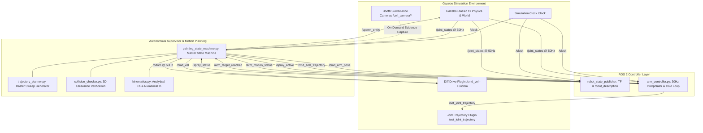
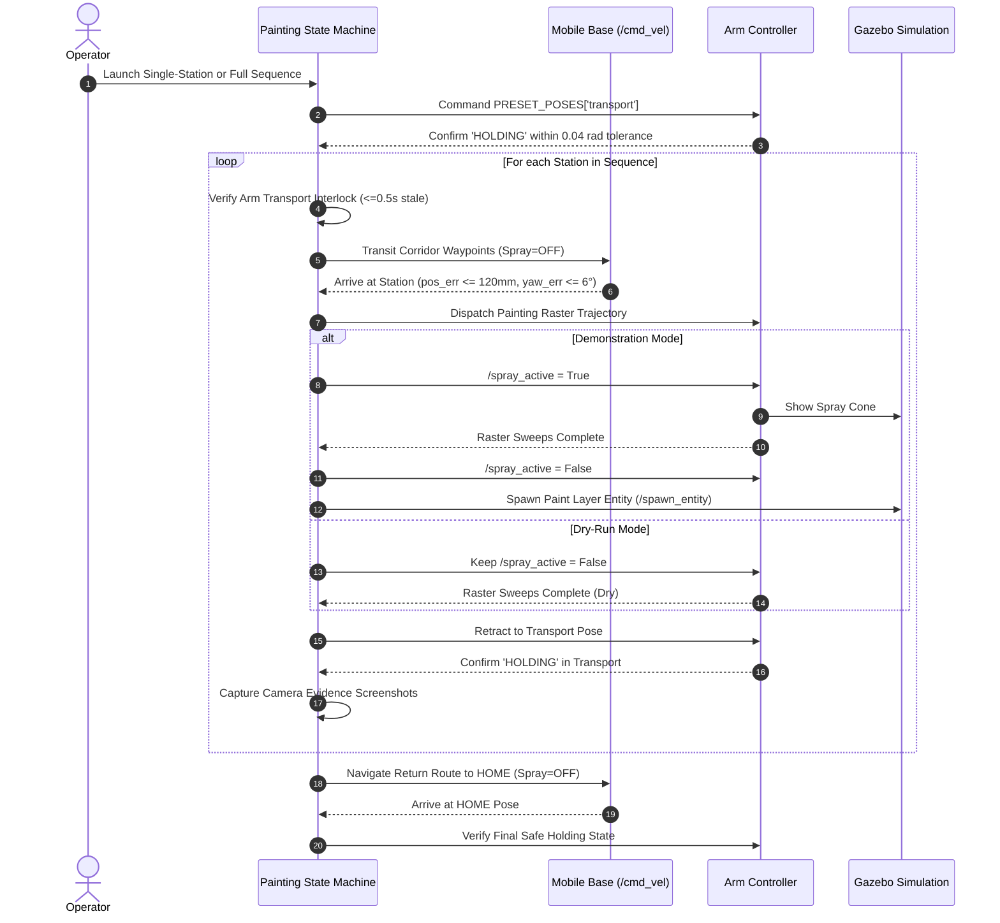

# System Architecture & Technical Specifications
## Robotic Car Painting Cell Simulation

This document describes the software architecture, coordinate frames, kinematic chain, communications graph, and control interfaces of the robotic car painting cell simulation.

---

## 1. System Architecture Overview

The robotic painting cell consists of:
1. **Simulation World (`worlds/car_painting_cell.world`):** A $14\text{m} \times 12\text{m} \times 5\text{m}$ industrial paint booth enclosure containing an automotive body staging area, safety hazard boundaries, and an executive sedan body ($4.80\text{m} \times 1.90\text{m} \times 1.60\text{m}$).
2. **Mobile Painting Manipulator (`mobile_painting_robot.urdf.xacro`):**
   - A 4-wheeled differential-drive mobile base ($0.80\text{m} \times 0.60\text{m}$).
   - A 6-DOF articulated painting arm mounted on the base chassis.
   - An pneumatic spray-gun end-effector with an active spray-cone visualizer.
3. **ROS 2 Control & Planning Nodes:**
   - `arm_controller.py`: 30 Hz joint trajectory interpolator, position holder, and gravity-deflection compensator.
   - `painting_state_machine.py`: Autonomous supervisor orchestrating base navigation, station validation, trajectory dispatch, safety interlocks, and evidence capture.
   - `trajectory_planner.py`: Generates surface-adaptive raster painting sweeps and standoff trajectories.
   - `collision_checker.py`: Dense geometric clearance verification.
   - `kinematics.py`: Analytical forward and numerical damped least-squares inverse kinematics solver.

---

## 2. System Component Diagram



---

## 3. Station Layout & Standoff Corridors

The car body is staged centrally at the world origin $(0.0, 0.0, 0.0)$. Standoff corridors maintain $\ge 1.0\text{m}$ clearance from the vehicle perimeter:

```
                          [FRONT HOOD]
                     (X=3.00, Y=0.00, Yaw=-90°)
                                |
[FRONT] -----------------+------+------+----------------- [REAR]
(X=3.50, Y=0.00,         |    CAR      |                  (X=-3.50, Y=0.00,
 Yaw=180°)               |   BODY      |                   Yaw=0°)
                         +------+------+
                                |
                           [ROOF / LEFT]
                     (X=0.00, Y=1.85, Yaw=-90°)
                                |
                             [HOME]
                     (X=0.00, Y=2.45, Yaw=-90°)
```

### Station Definitions:
- **HOME:** $(0.00, 2.45, -90^\circ)$ — Safe staging pose outside robot work corridor.
- **FRONT:** $(3.50, 0.00, 180^\circ)$ — Aligned normal to front bumper.
- **LEFT_SIDE:** $(0.00, 2.00, -90^\circ)$ — Aligned normal to driver-side door panels.
- **REAR:** $(-3.50, 0.00, 0^\circ)$ — Aligned normal to rear bumper and trunk.
- **RIGHT_SIDE:** $(0.00, -2.00, 90^\circ)$ — Aligned normal to passenger-side door panels.
- **FRONT_HOOD:** $(3.00, 0.00, -90^\circ)$ — Staged for elevated hood raster sweeps.
- **ROOF:** $(0.00, 1.85, -90^\circ)$ — Elevated stance for roof panel coating.

---

## 4. State Machine Execution Sequence



---

## 5. Kinematics Specifications

The painting manipulator consists of 6 revolute joints:
1. `arm_base_joint`: Base azimuth rotation $[-\pi, \pi]$
2. `shoulder_joint`: Shoulder elevation $[-\pi, \pi]$
3. `elbow_joint`: Elbow articulation $[-\pi, \pi]$
4. `wrist_1_joint`: Pitch angle $[-\pi, \pi]$
5. `wrist_2_joint`: Yaw angle $[-\pi, \pi]$
6. `wrist_3_joint`: Roll angle $[-\pi, \pi]$

### End-Effector Standoff:
- Target spray standoff distance: **0.25m – 0.30m** normal to vehicle surface.
- Measured live standoff during FRONT bumper painting sweeps: **0.269m – 0.275m** (within optimal automotive atomization window).
